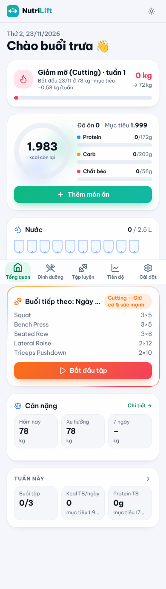
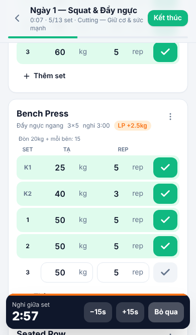

# NutriLift 🥗🏋️

**Theo dõi dinh dưỡng + luyện tập tạ trong một ứng dụng** — kết hợp và nâng cấp hai dự án mã nguồn mở
[OpenNutriTracker](https://github.com/simonoppowa/OpenNutriTracker) (nhật ký dinh dưỡng) và
[Liftosaur](https://github.com/astashov/liftosaur) (chương trình tập tự tăng tạ).

Thiết kế cho người tập tạ đi theo chu kỳ **giảm mỡ (cutting) → duy trì → tăng cơ (bulking)**, dùng lâu dài,
chạy trên **điện thoại và máy tính**, đồng bộ qua Internet (không cần chung wifi), vẫn dùng được khi mất mạng.

> 📖 Hướng dẫn từng bước (đưa app lên mạng, bật đồng bộ, cài lên điện thoại): **[HUONG_DAN.md](HUONG_DAN.md)**

| Điện thoại | Máy tính (chế độ tối) |
| --- | --- |
|   |  |

## Tính năng

### Dinh dưỡng (từ OpenNutriTracker, đã mở rộng)
- Nhật ký 4 bữa (sáng/trưa/tối/ăn vặt), nước uống, vận động (MET theo Compendium — như ONT).
- Tìm món: **CSDL ~150 món ăn & thực phẩm Việt Nam ngoại tuyến** (phở, bún bò, cơm tấm, bánh mì…), tìm không dấu;
  **Open Food Facts** và **USDA FoodData Central** trực tuyến; **quét mã vạch** bằng camera (BarcodeDetector / ZXing).
- **📷 Chụp món ăn bằng AI (Gemini)**: nhận diện từng món, ước tính gam & calo, ghép với CSDL món Việt, sửa trước khi lưu.
- Món tự tạo, **công thức** (tính dinh dưỡng mỗi phần), món yêu thích, món gần đây, chép bữa từ hôm qua, nhập nhanh kcal/macro.
- Công thức TDEE: Mifflin-St Jeor, IOM 2005 (giống ONT), Katch-McArdle (khi biết % mỡ).

### Luyện tập (từ Liftosaur, đã mở rộng)
- Chương trình viết bằng **Liftoscript-lite** — tương thích phần cú pháp phổ biến của Liftosaur, nên **dán được chương trình từ liftosaur.com**:
  `Squat / 3x5 / 60kg / 180s / progress: lp(2.5kg)` · rep range `3x8-12` · AMRAP `1x5+` · `75%` 1RM · `@8` RPE · tuần/buổi · warmup.
- Tự tăng tạ: **lp** (tuyến tính, có deload khi trượt), **dp** (double progression), **sum** (tổng rep).
- Màn hình tập: đánh dấu set, sửa tạ/rep nhanh, **đồng hồ nghỉ** (âm báo, rung, thông báo), **tính bánh tạ**, set khởi động tự động
  (30/50/80% như Liftosaur), lần tập trước, đổi/thêm/xoá bài, giữ màn hình sáng.
- 218 bài tập (thư viện Liftosaur) kèm **nhóm cơ & tên tiếng Việt**, bài tự tạo, lịch sử, **kỷ lục cá nhân**, biểu đồ 1RM ước tính,
  thống kê **số set mỗi nhóm cơ/tuần**.
- 7 chương trình mẫu tiếng Việt, gồm **"Cutting — Giữ cơ & sức mạnh"** và **"Bulking — Tăng cơ 5 buổi"**.

### Phần kết hợp mới (không có ở 2 app gốc)
- **Giai đoạn Cut / Duy trì / Bulk**: đặt tốc độ (%/tuần), cân mục tiêu → calo & macro tự tính; lịch sử các giai đoạn.
- **TDEE thích ứng** (kiểu MacroFactor): ước tính năng lượng tiêu hao thật từ calo đã ăn + xu hướng cân nặng; **check-in hằng tuần** đề xuất mục tiêu mới.
- Macro cho người tập: protein theo **g/kg** (2,2 khi cut, 1,8 khi bulk), chất béo tối thiểu, carb phần còn lại.
- **Calorie cycling** ngày tập/ngày nghỉ (giữ nguyên trung bình tuần); tuỳ chọn cộng calo vận động.
- Buổi tập tự ghi calo vào nhật ký vận động; ngày có buổi tập tự thành "ngày tập".
- **Theo dõi giữ sức mạnh khi cutting**: so sánh 1RM ước tính từ đầu giai đoạn.
- Đường xu hướng cân nặng (EMA), số đo cơ thể, ước tính % mỡ (công thức US Navy).
- **Nhập dữ liệu cũ**: lịch sử tập CSV của Liftosaur, file xuất ZIP/JSON của OpenNutriTracker.

### Đa thiết bị
- **PWA**: cài lên màn hình chính iPhone/Android, cài như ứng dụng trên Windows/macOS; chạy ngoại tuyến.
- **Local-first**: dữ liệu luôn nằm trong IndexedDB của thiết bị; đồng bộ qua **Supabase** (miễn phí, của riêng bạn),
  gộp theo bản sửa mới nhất, đồng bộ cả thao tác xoá, cập nhật gần như tức thì (Realtime).
- Sao lưu / khôi phục file JSON.

## Chạy trên máy (dành cho lập trình viên)

```bash
npm install
```

```bash
npm run dev        # http://localhost:5173
```

```bash
npm test           # 42 unit test (tính toán, Liftoscript, tiến độ, đồng bộ, nhập dữ liệu)
```

```bash
npm run build      # xuất ra thư mục dist/ (web tĩnh, deploy ở đâu cũng được)
```

Cấu trúc chính:

```
src/
  db/          Dexie (IndexedDB), kiểu dữ liệu, ghi kèm hàng đợi đồng bộ
  nutrition/   TDEE, macro, TDEE thích ứng, CSDL món Việt, Open Food Facts, USDA, MET
  training/    thư viện bài tập, Liftoscript-lite, tiến độ lp/dp/sum, khởi động, bánh tạ, thống kê
  sync/        engine đồng bộ, Supabase, sao lưu, nhập từ Liftosaur/ONT
  pages/       giao diện (React + Tailwind)
supabase/schema.sql   bảng + trigger last-write-wins + Row Level Security
```

## Deploy
- **GitHub Pages**: đã có sẵn workflow `.github/workflows/deploy.yml` (bật Settings → Pages → Source: GitHub Actions).
- **Vercel / Netlify / Cloudflare Pages**: build `npm run build`, thư mục `dist`. Dùng hash routing nên không cần cấu hình rewrite.

## Giấy phép & ghi công
Phát hành theo **AGPL-3.0-or-later** (xem `LICENSE`), vì có sử dụng dữ liệu/logic từ:
- **Liftosaur** © Anton Astashov — AGPL-3.0: thư viện bài tập & nhóm cơ, cú pháp Liftoscript, quy tắc lp/dp/sum, sơ đồ khởi động, định dạng CSV.
- **OpenNutriTracker** © Simon Oppowa — GPL-3.0: công thức TDEE IOM 2005/PAL, tính MET, hệ số bù calo vận động, cấu trúc dữ liệu Open Food Facts/USDA, định dạng xuất dữ liệu.

Dữ liệu sản phẩm từ [Open Food Facts](https://world.openfoodfacts.org) (ODbL) và [USDA FoodData Central](https://fdc.nal.usda.gov) (public domain).
Giá trị dinh dưỡng chỉ mang tính tham khảo, không thay thế tư vấn y tế.
